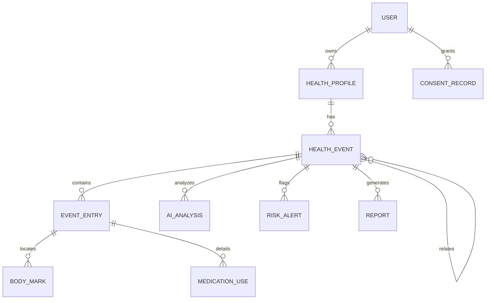

# Health V0.1 概念数据模型（需求阶段）

> 本文定义业务实体、字段口径与关系，不等同最终数据库设计。禁止使用真实个人健康数据作为公开仓库样例。

## 1. 实体关系（概念）

第一版一个用户原则上只维护一个本人档案；为将来家庭模式预留 profile_id，但默认不可跨档案访问。

## 2. 实体说明与建议字段

### 2.1 User / HealthProfile

- User：id、登录标识（按必要性选择）、创建时间、账号状态。
- HealthProfile：id、user_id、昵称/称谓、出生年份或年龄段（可选）、个人自填的重要医疗情况、过敏史、更新时间。
- 不应强制收集身份证号、住址、完整生日；不要把可选项设计为 AI 诊断所必需。

### 2.2 HealthEvent（健康事件）

- id、profile_id、title、chief_concern（用户主诉）、status（open/closed）、onset_at（可为空）、onset_precision、closed_at、created_at、updated_at、timezone。
- recurrence_of_event_id（可空）仅表示用户指认的相关性，不代表同一疾病。
- resolved_summary：用户总结，非系统医学判定。
- 事件 ID 应为不可预测的稳定标识；所有数据访问经服务端所属关系校验。

### 2.3 EventEntry（事件条目）

- id、event_id、entry_type（symptom / medication / observation / encounter / test / note / change）。
- occurred_at、occurred_precision（exact / approximate / unknown）、recorded_at、updated_at、created_by、source_type（self_report / imported_pending / clinician_document / ai_generated）。
- narrative（用户原话）、structured_payload（类型化字段；最终需确定独立表还是 JSON）。
- symptoms: complaint_code（产品内部症状字典）、quality、severity_0_10（可为空）、duration、frequency、associated_symptoms、progress（better/worse/unchanged/unknown）。
- 修改留痕优先采用记录版本/修订记录，避免假装历史信息始终准确。

### 2.4 BodyMark（人体部位标记）

- id、entry_id、map_version、view（front/back/unspecified）、zone_code、zone_label_snapshot。
- laterality（left/right/bilateral/midline/not_applicable/unknown）、local_segment（可空）、marker_type（primary/radiating/other）、linked_mark_id（可空）。
- 可选 normalized_x/normalized_y 用于示意图热点，但**真正的语义依据是 zone_code**，不能只靠坐标。
- 不适用于无明确位置的症状时，允许 BodyMark 为空；症状独立保存。

### 2.5 MedicationUse（实际用药）

- id、entry_id、name_input（用户录入名称）、standard_name（可空/经确认）、form（剂型）、strength_text（包装规格，如用户所见）。
- dose_amount、dose_unit、dose_text_original、route（如用户知道）、used_at、usage_status（actual/planned/not_taken/unknown）、source（self_report / prescription_reported）。
- reaction_text、reaction_observed_at、is_user_confirmed、ocr_extraction_ref（如采用 OCR）；必须保留原始录入文字以便核对。
- **剂量表示特别注意：** 一片与 100 mg 不能任意换算；没有浓度/规格上下文时不得自动算出等价剂量。
- 可关联药品目录，但目录匹配与用户实际服用事实是不同信息。

### 2.6 AIAnalysis

- id、event_id、analysis_at、source_entry_ids / snapshot_hash、model_id、prompt_template_version、rule_set_version。
- summary_facts、missing_information、possible_explanations、recommended_next_step、uncertainty_note。
- status（complete/failed/abstained）；risk_tier_display 与 RiskAlert 的结果必须可区分。
- 禁止模型直接写回病史、诊断、药品事实字段；由用户确认后创建新记录。

### 2.7 RiskAlert

- id、event_id、source_entry_ids、rule_id、rule_version、severity（emergency/urgent/info）、trigger_facts、detected_at、displayed_at、acknowledged_at（可空）。
- 明确区分规则命中、模型提出的疑似风险、用户是否确认已查看；不以“用户关闭弹窗”解释为风险解除。
- 不存储“正常/安全”最终结论；无命中仅表述为“本次资料未识别相应预警信号”。

### 2.8 Report / Consent / Audit

- Report：id、profile_id、event_ids/date_range、included_sections、generated_at、source_snapshot_hash、export_format、owner_confirmed_at。
- ConsentRecord：user_id、purpose（record_storage / external_ai / share_report 等）、text_version、granted_at、revoked_at、processor_context。
- AuditLog：主体、动作、对象 ID、时间、结果和最小必要技术信息；避免原始症状/药名/报告正文进入普通日志。

## 3. 初始人体部位字典（示例）

| 一级 | 二级示例 | 特殊要求 |
|---|---|---|
| 头颈 | 前额、太阳穴、头顶、后枕、颈前/后 | 双侧/中线，支持头晕等不定位症状 |
| 胸部 | 胸前、胸骨后、左右胸侧 | 视觉区与内部器官诊断区别明确 |
| 腹部 | 上腹、脐周、左右腹、左右下腹、下腹 | 可提供分区图，但不能用于自动确认病变器官 |
| 背腰 | 上背、肩胛区、腰部、尾骶部 | 背面选取，支持放射关系 |
| 上肢 | 肩、上臂、肘、前臂、腕、手 | 左右、关节与肢体区分 |
| 下肢 | 髋、大腿、膝、小腿、踝、足 | 左右、关节与肢体区分 |
| 全身/其他 | 全身不适、说不清位置、无明确位置 | 无需 BodyMark |

人体图版本升级时应保留旧图映射关系和名称快照，保证历史报告可重现。

## 4. 一致性与安全约束

1. 不允许孤立的用药数据没有日期或缺少用户归属；实际服药时间未知时单独标记，不能猜测。
2. 事件结束不意味着全部症状已消失；文本避免“自动康复”。
3. 报告所述事实引用当时快照，不能因之后修改而悄然更改已经导出的 PDF。
4. 多条症状可同时发生，AI 不能强制合并为一个诊断。
5. 外部 AI 只接收本次获授权的最小必要信息；不得默认传完整档案。
6. 图片附件、药盒照片、就医报告如后续加入，需独立对象存储、严格授权及敏感内容保护。
7. 预留国际标准映射可能：FHIR Patient / Condition / Observation / MedicationStatement / Encounter / DocumentReference 等作为概念参考，实际标准与版本由互通需求决定。

## 5. 下一步需验证

- 症状字典一级/二级粒度，以及人体 SVG 图与中文名称的对应关系。
- 药物记录的用药频率、按次服用和长期用药是否共用一套对象。
- 历史数据编辑策略：直接更新+审计，还是全部以事件修订方式表示。
- V0.1 是否完全个人单档案，以及首次登录方式。
- PDF 是否只保留事件摘要，还是附上详细条目原始数据。

---

## 6. 2026-11-17 数据模型扩展：就医、医嘱与执行事实

**重要分离：** \`Encounter\` = 实际就医；\`ClinicianInstruction\` = 医生提出的请求/建议（用户记录/转录）；\`MedicationUse\` = 用户报告实际用药；\`TreatmentPerformed\` = 用户报告实际接受的治疗。这四类实体不相互替代，也不因医嘱状态“已执行”而自动生成服药或治疗事实。

### 6.1 Encounter（一次就医）

- id, health_event_id, visited_at, facility_name, department, clinician_name (optional)
- notes_original, diagnosis_reported (optional), source_type, source_attachment_ids
- recorded_at, edited_at, user_confirmed_at

用户录入“医生诊断”时必须标注来源为“用户转录/待核实”，不得让 AI 自动转为医学已确认的病史。

### 6.2 ClinicianInstruction（医嘱/处方/建议）

- id, health_event_id, encounter_id (optional), instruction_type (prescription/treatment/test/followup/lifestyle/other)
- instruction_text_original, issued_at, source_type (self_report/document_transcribed/verified_import)
- user_execution_status (unknown/not_started/in_progress/reported_completed)
- source_attachment_ids, supersedes_instruction_id (optional), recorded_at, revised_at, confirmation_state
- 对药物处方可扩展 \`PrescriptionItem\`：drug_name, strength, dosage, unit, route, frequency, start/end, duration, quantity, refills, unknown_fields。OCR 提取内容必须经用户核对。

### 6.3 TreatmentPerformed（实际治疗执行）

- id, event_id, instruction_id (optional), performed_at, treatment_name, quantity_or_sessions (optional)
- facility, notes_user_reported, response_user_reported, source_type, recorded_at

一条治疗医嘱可关联多条执行记录。治疗反应是用户自述，不等于疗效因果结论。

### 6.4 MedicationUse 扩展

- 新增 \`instruction_id\` 或 \`prescription_item_id\` 可空关联。
- 实际用药与处方的药名/剂量分别保留，若不一致应如实展示，**不自动修正剂量，不自动给出停换药建议**。
- 未记录实际服用 ≠ 未服用；医嘱标记“已完成” ≠ 系统已经核实所有服药记录。

### 6.5 报告范围与来源字段

- \`Report.report_mode\`：previsit（就医前事实摘要）/ full_course（含医嘱与治疗全程）
- \`Report.included_entry_ids\`、\`source_snapshot_hash\`、\`generated_at\` 与可选 AI 附录。
- 区分 \`self_report\`、\`document_transcribed\`、\`verified_import\`；原型当前仅支持前两者的文字类别，后者须真正集成可信机构来源后才能启用。
- 建议将所有时间线条目统一附加 \`encounter_id\`、\`instruction_id\`、\`source_type\` 及修改记录，以支持历史审计。

业务关系及验收案例详见 [CARE-AND-ORDERS-V0.1.md](./CARE-AND-ORDERS-V0.1.md)。
